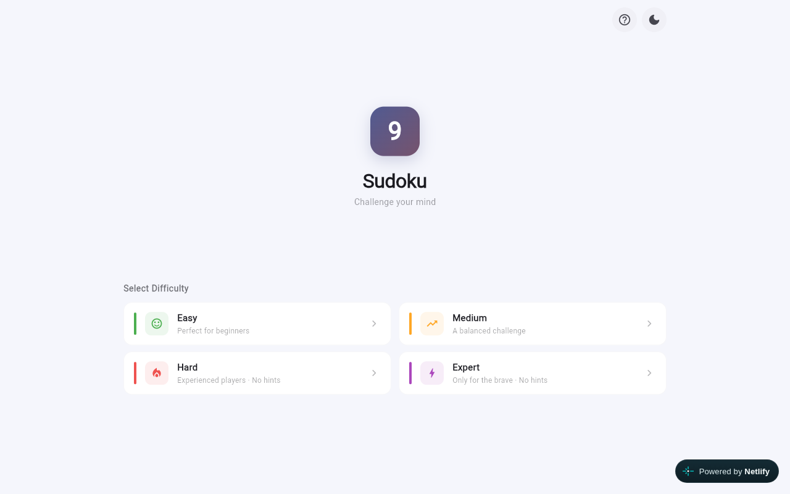
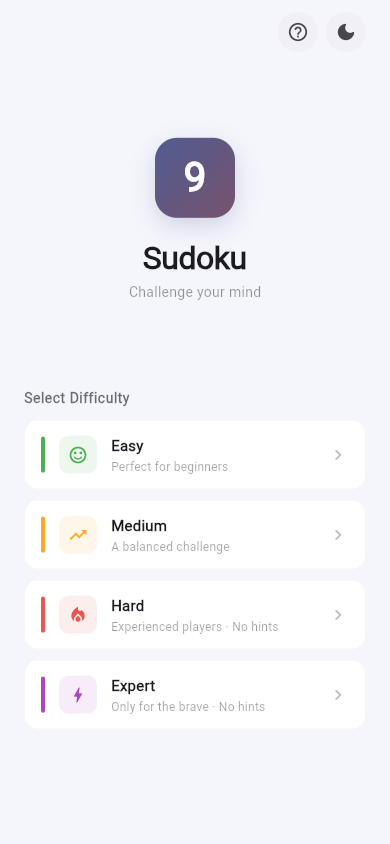
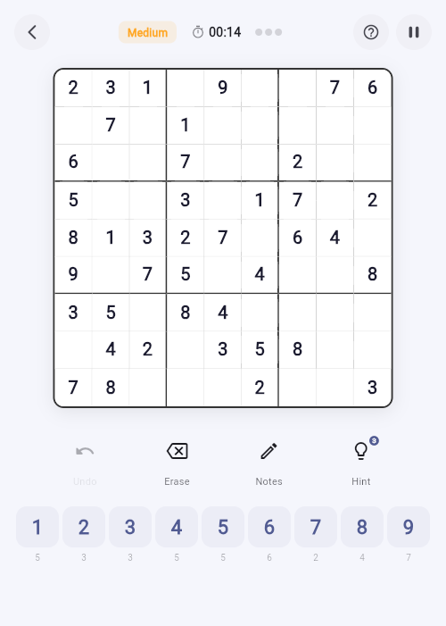
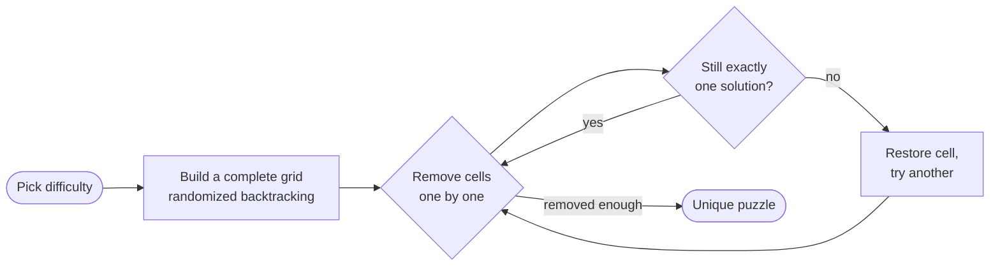

<div align="center">


<br>

[](LICENSE)
[](https://flutter.dev)
[](https://github.com/AshutoshSajan/sudoku/releases)
[](#-installation)
[](https://solve-sudoku.netlify.app)
[](https://github.com/AshutoshSajan/sudoku/actions)

**[Features](#-features) · [Installation](#-installation) · [Quick start](#-quick-start) · [How it works](#-how-it-works) · [Privacy](#-privacy) · [Troubleshooting](#-troubleshooting) · [Development](#-development)**

</div>

---

## 📖 Overview

**Sudoku** is an offline-first puzzle game built with Flutter (Material 3): standard 9×9 puzzles in 4 difficulties, pencil-mark notes, mistake highlighting, hints, autosave with resume, and light/dark themes. No accounts, no ads, no network calls — all state stays on device.

It was written as a clean, FOSS alternative to ad-ridden Sudoku apps: everything is GPL-3.0-only, reproducible from the `vX.Y.Z` tags, and one codebase ships to Android, Linux, Windows, and the Web.

> [!TIP]
> **🎮 [Play it live](https://solve-sudoku.netlify.app)** — no install needed. Your progress autosaves in the browser.

## 🖼 Preview

<div align="center">


<br><sub><b>Home on desktop web</b> — the layout adapts: 2×2 difficulty grid on wide screens, list on phones.</sub>

<br><br>

<table>
<tr>
<td align="center"><br><sub><b>Home on Android</b>: Easy → Expert</sub></td>
<td align="center"><br><sub><b>Mid-game on Medium</b>: board, erase/notes/hint bar, number pad</sub></td>
</tr>
</table>

<sub><i>Screenshots are from the real app (desktop browser + Android). No mockups.</i></sub>
</div>

## ✨ Features

### 🎯 Play your way

- **4 difficulties** — Easy · Medium · Hard · Expert. Every puzzle is verified to have exactly one solution.
- **Hints** — 3 per game on Easy/Medium. Disabled on Hard & Expert: you're on your own. 🔥
- **Mistake limit** — 3 wrong entries ends the game. Play carefully.
- **Timer** — auto-pauses in the background; manual pause hides the board from prying eyes.
- **Autosave with resume** — leave mid-game and come back to a resume card on the home screen. Finished and lost games never resume.

| Level | Cells removed | Hints |
|:------|--------------:|:-----:|
| Easy | 30 | 3 |
| Medium | 40 | 3 |
| Hard | 50 | — |
| Expert | 55 | — |

### ✏️ Learn & improve

- **Notes mode** — pencil-mark candidates; marks auto-clean when digits land.
- **Undo & erase** — full move history, one-tap erase.
- **Mistake highlighting** — wrong entries tell you immediately.
- **Tooltips** — hover / long-press any icon to learn it; in-game help via the **?** icon.
- **Keyboard shortcuts** — full laptop-keyboard play, plus a touch keyboard on mobile:

| Keys | Action |
|------|--------|
| `1`–`9` | Place digit |
| `0` / Backspace | Erase cell |
| Arrow keys | Move selection |
| `U` / `N` / `H` | Undo / notes mode / hint |

### 🎨 Feels right

- **System-aware themes** — light, dark, or follow the device, toggleable in-app.
- **Responsive** — full-width board on phones, even grids on desktop, scroll fallback on tiny windows.
- **100% offline** — no accounts, no ads, no analytics, no network. Your games never leave the device.

## 🚀 Installation

Grab a build from **[GitHub Releases](https://github.com/AshutoshSajan/sudoku/releases)** (every `vX.Y.Z` tag ships all formats), or run the [web version](https://solve-sudoku.netlify.app).

| Platform | What to download | Notes |
|----------|-----------------|-------|
| **Android** | `-arm64.apk` / `-arm.apk` / `-x64.apk` (or `-universal.apk`), or `-release.aab` | 6.0+. Allow "install unknown apps" once; the APKs are signed with the release key. |
| **Linux** | `.deb` / `.rpm` / `-linux-x64.tar.gz` / `.AppImage` / `.snap` | glibc ≥ 2.35 (Ubuntu 22.04+, Debian 12+, Fedora 36+). The AppImage needs `libfuse2` on newer distros (see [troubleshooting](#-troubleshooting)). |
| **Windows** | `-setup.exe` / `-portable.zip` | 10+ x64. The `.exe` is unsigned so SmartScreen warns — the portable `.zip` skips it. |
| **Web** | `-web.zip`, or just [play live](https://solve-sudoku.netlify.app) | Any modern browser. |

**Store status:** F-Droid submission is in review ([#51869](https://gitlab.com/fdroid/fdroiddata/-/merge_requests/51869)); Chrome Web Store and Firefox listings are planned. Until then, Releases are the source of truth.

> [!TIP]
> **Updating:** install the new file over the old one. On Android your autosaved game survives the update.

## 🧭 Quick start

1. **Pick a difficulty** — Easy if it's your first grid, Medium for a real game.
2. **Select a cell** — tap/click it, or move with the arrow keys.
3. **Enter digits** — number pad, touch keyboard, or keys `1`–`9`.
4. **Stuck?** — toggle **Notes** (`N`) and pencil in candidates; spend a **Hint** (`H`) on Easy/Medium.
5. **Slipped?** — **Undo** (`U`) or **Erase**; three mistakes ends the run.
6. **Interrupted?** — just leave. The home screen offers to resume where you stopped.

**The only rule:** fill the 9×9 grid so every row, column, and 3×3 box contains 1–9 exactly once. Locked cells can't be changed.

## 🧠 How it works

### Puzzle generation



1. A complete grid is built with randomized backtracking (seeded diagonal boxes).
2. Cells are removed one by one — a removal sticks only if the puzzle still has exactly one solution (capped solver check).
3. Generation runs on a background isolate, so the UI never freezes.

`lib/models/sudoku_game.dart` holds state, generation, solver, and rules in one place; `lib/services/game_storage.dart` persists the in-progress game to `shared_preferences` (`autosave_game_v1`).

## 🔒 Privacy

Everything stays **on your device**, in local app storage. The app has no server, no analytics, no accounts, and makes no network requests — the web build is a static bundle. You can inspect all of the code; the only third-party packages are Flutter's own (`cupertino_icons`, `shared_preferences`).

## 🧯 Troubleshooting

<details>
<summary><b>The AppImage won't start on a recent distro</b></summary>

Type-2 AppImages need FUSE 2, which Ubuntu 22.04+ and Fedora don't ship: `sudo apt install libfuse2` (or use the `.deb` / `.tar.gz` instead).
</details>

<details>
<summary><b>Android refuses to install the APK</b></summary>

Allow "Install unknown apps" for your browser/file manager when prompted. If Play Protect warns, that's expected for apps outside the Play Store — the APK hash is published in `SHA256SUMS.txt` on the release page so you can verify the download.
</details>

<details>
<summary><b>SmartScreen warns about the Windows installer</b></summary>

The `.exe` is unsigned in v1 (signing is a documented follow-up). The portable `.zip` runs without any warning — unzip and launch.
</details>

<details>
<summary><b>The web version shows a blank page</b></summary>

Use a current Chrome, Edge, Brave, or Firefox — Flutter web needs WebAssembly and modern JS. Very old browsers and some in-app WebViews can't render it.
</details>

<details>
<summary><b>My in-progress game is gone</b></summary>

Finished and lost games are deleted on purpose and never resume. If the app data itself was cleared (reinstall, browser storage wipe), the autosave goes with it — there's no cloud backup by design.
</details>

<details>
<summary><b>Something doesn't work and I need to report it</b></summary>

Open an [issue](https://github.com/AshutoshSajan/sudoku/issues) with your platform, app version, difficulty, and what happened. A screenshot of the board state helps.
</details>

## 📁 Project structure

```text
.
├── lib/
│   ├── main.dart              # Entry point, theme mode state
│   ├── models/sudoku_game.dart# State, generation, solver, rules
│   ├── services/game_storage.dart # Autosave / resume via shared_preferences
│   ├── screens/
│   │   ├── home_screen.dart   # Landing + difficulty grid + resume card
│   │   ├── game_screen.dart   # Gameplay (board, controls, keyboards)
│   │   └── help_screen.dart   # In-game "How to Play" guide
│   ├── theme/app_theme.dart   # Material 3 light/dark themes
│   └── widgets/               # Board, number pad, action bar, header, dialogs
├── test/                      # Unit + widget tests (flutter test)
├── packaging/                 # Desktop icon, nfpm (deb/rpm), Inno Setup (exe)
├── snap/                      # Snap Store packaging (core22)
├── extension/                 # Chrome/Firefox popup (embeds the web build)
├── fastlane/                  # F-Droid / store metadata + screenshots
├── tool/netlify-build.sh      # Web CI bootstrap (Flutter from upstream)
├── netlify.toml               # Web deploy config
├── CONTRIBUTING.md            # Branching, releases, conventional commits
├── LICENSE                    # GPL-3.0-only
└── README.md
```

## 🛠 Development

**Prerequisites:** [Flutter SDK](https://docs.flutter.dev/get-started/install) 3.x · Chrome for web · Android Studio for Android.

```bash
flutter pub get

flutter run -d chrome   # web
flutter run -d linux    # desktop
flutter run             # Android device / emulator
```

```bash
flutter analyze && flutter test   # required before every PR
flutter build web --release
flutter build apk
```

- Every feature/fix goes on its own branch **from `dev`** (`feature/…`, `bugfix/…`, `docs/…`) with a [Conventional Commits](https://www.conventionalcommits.org/) message; see [CONTRIBUTING.md](CONTRIBUTING.md) for the release flow.
- One tag (`vX.Y.Z` on `main`) builds and publishes every distributable — never commit to `main` directly.

## 🗺 Roadmap

- [x] Autosave with resume, keyboard support, in-game help, responsive layouts
- [x] One-tag multi-format binary releases (apk/aab/deb/rpm/AppImage/snap/exe/web)
- [x] Snap packaging, F-Droid metadata + submission
- [ ] F-Droid inclusion (in review: [!51869](https://gitlab.com/fdroid/fdroiddata/-/merge_requests/51869))
- [ ] Chrome Web Store listing
- [ ] Signed Firefox add-on
- [ ] Snap Store listing
- [ ] Signed Windows installer (no more SmartScreen warning)

## 🤝 Contributing

Issues and pull requests are welcome — see [CONTRIBUTING.md](CONTRIBUTING.md) for branches, commits, and checks. For larger changes, open an issue first. Please run `flutter analyze && flutter test` before opening a PR.

## 📄 License

Released under the [GPL-3.0-only License](LICENSE). A copy of the license text ships inside every distributable.

<div align="center">
<sub>Built with 💙 using Flutter · one codebase, every screen. 🧩</sub>
</div>
